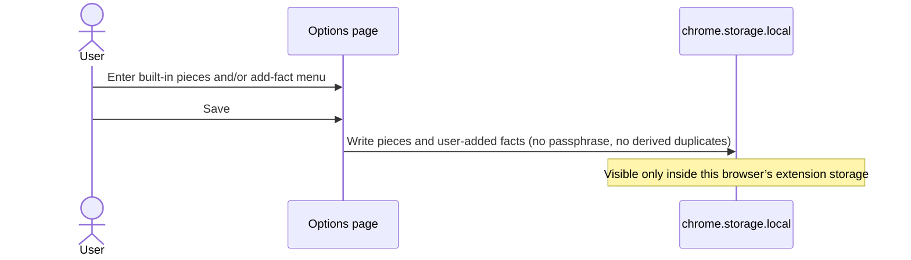

# Application autofill — Design

## Overview

This feature is a Manifest V3 browser extension written in TypeScript. One unpacked package is loaded into Chrome and, separately, into Opera GX. Each browser keeps its own `chrome.storage.local` profile (unencrypted, no passphrase). The options page is where built-in pieces and user-added facts are entered. Clicking the toolbar icon turns auto-mode on and fills the current tab only when that tab is a job application. While auto-mode stays on, later application pages and steps are filled without another click. A fill writes stored facts into fields that have no value; it never overwrites a field that already has a value, never invents text, and never activates Submit, Next, Continue, or agree-to-terms. The page never reads the stored profile; it only sees values written into its own controls.

The repo has no product code yet. The parts below are the extension itself: options page, popup, service worker, content script, profile store, and fill engine.

## Architecture

One extension package serves both browsers. Storage is not shared between them because each browser has its own extension storage area.

| Component | Responsibility |
| --- | --- |
| Manifest V3 package | Declares the service worker, options page, popup, content script, and host access needed to run on application pages. Loaded unpacked from a local folder in Chrome and in Opera GX. No remote endpoints. |
| Options page | View, enter, and save built-in profile pieces and one resume file. Hosts a basic, non-stylized add-fact menu (fact value plus the question strings it maps to). Reads and writes only this browser’s `chrome.storage.local`. |
| Popup | Shown when the user clicks the toolbar icon. On open, turns auto-mode on and asks the content script to fill the current tab if it is a job application. Presents an on/off control; turning it off is the only user action that ends auto-mode before a new browser session. |
| Service worker | Owns auto-mode in session-scoped storage so a new browser session starts with auto-mode off while the saved profile remains. Relays fill requests. Does not send profile contents off the machine. |
| Content script (isolated world) | Runs on the tab. Classifies the page as a job application or not. Collects field cues. Maps empty fields to stored facts. Writes values as if typed or selected. Attaches the resume only to an empty resume/CV upload. Never clicks submit/advance controls. |
| Profile store | `chrome.storage.local` JSON of built-in pieces and user-added facts. Isolated from web pages and from other extensions. No passphrase. No second derived copy of a fact (no stored full-name string alongside first/middle/last). |
| Resume store | The chosen resume file kept locally next to the profile in this browser only. Metadata (file name, MIME type) lives with the profile JSON; bytes stay on the machine. |
| Fill engine | Pure mapping and compose/split used by the content script: name by field count (or exact English/Spanish labels when there are four or more), phone join/split, address street-numbers/details/localidad, date of birth as one field or month/day/year, user-added exact cue match, ambiguity → leave unchanged, skip fields that already have a value. |

Web pages, other extensions, analytics, and crash reporters are not components of this feature. The content script does not use the page’s `localStorage`.

## Data flow

Main success path: the user has a saved profile in this browser, clicks the toolbar icon on a job application, then continues to later application steps with auto-mode on.

```mermaid
sequenceDiagram
    actor User
    participant Icon as Toolbar icon / popup
    participant SW as Service worker
    participant Store as chrome.storage.local
    participant Session as Session storage
    participant CS as Content script
    participant Page as Application page

    User->>Icon: Click extension icon
    Icon->>SW: Popup opened
    SW->>Session: Set auto-mode on
    Icon-->>User: Show auto-mode on/off control
    SW->>CS: Fill current tab
    CS->>Page: Classify page (job application or not)
    alt Tab is not a job application
        CS-->>Page: Do not change any fields
    else Tab is a job application
        CS->>Store: Read profile and resume in isolated world
        CS->>Page: Collect fields and cues
        CS->>CS: Map empty fields; skip valued, ambiguous, and unmapped
        CS->>Page: Write stored values; attach resume if upload empty
        Note over CS,Page: Do not activate Submit, Next, Continue, or agree-to-terms
    end

    User->>Page: Advance to next application step
    Page->>CS: Step becomes current
    CS->>Session: Auto-mode still on?
    CS->>Page: Classify; fill remaining empty mapped fields only
```

Failure and boundary paths (same components, no extra UI):

- Auto-mode off, or a new browser session (session storage empty): the content script does not fill.
- Login, checkout, or settings that is not a job application: classify as not an application; leave every field unchanged, including on icon click.
- Field already has a value, including a resume/CV upload that already has a file: skip that control; still fill other empty mapped fields.
- Missing or ambiguous mapping, would-invent, open-ended with no mapped fact, dual built-in and user-added match: leave that field unchanged.
- No stored facts, or a needed piece (middle name, street numbers, resume file) is missing or unavailable: leave those fields unchanged; fill other empty mapped fields.
- Profile saved in the other browser: this browser’s store does not contain it; fills use only this browser’s profile.

Save path (options page only):



## Interfaces

No network API. Contracts are the extension surfaces and the in-extension messages.

### Options page

- **Opens:** browser extension options UI.
- **Inputs:** built-in piece fields listed in the requirements; one resume file picker; add-fact menu with a fact value and one or more question strings.
- **Outputs:** persist to `chrome.storage.local` in this browser. After save, later fills in this browser use the new values.
- **Satisfies:** view/enter/save built-in facts; pieces not duplicates; no passphrase; add-fact menu; user-added storage; unpacked load in Chrome and Opera GX.

The add-fact menu is basic HTML (plain inputs, add/remove questions, save). It is not a stylized design system.

### Popup

- **Opens:** toolbar icon click (`default_popup`). In Manifest V3 that click opens the popup rather than `action.onClicked`, so popup-open **is** the icon click.
- **On open:** set auto-mode on; if the current tab is a job application, run a fill of empty mapped fields (including an empty resume/CV upload).
- **Control:** a toggle or equivalent that turns auto-mode on or off. Off does not fill until auto-mode is on again. Icon click never turns auto-mode off.
- **Satisfies:** icon click turns auto-mode on; icon click fills only job applications; popup on/off; later icon click still fills remaining blanks.

### Service worker messages

- `SetAutoMode { on: boolean }` — popup writes session-scoped auto-mode.
- `GetAutoMode` → `{ on: boolean }` — missing session value means off (new browser session).
- `FillTab { tabId }` — popup or auto-mode trigger; content script decides whether the page is a job application and which empty fields to write.
- Profile and resume are read with `chrome.storage.*` from extension pages and the content script’s isolated world, not from page script.

### Content script fill entry

- **Input:** current DOM, this browser’s stored profile, auto-mode or explicit fill command.
- **Output:** in-page control values changed only for empty mapped fields; no navigation/submit activation.
- **Satisfies:** identification from cues; compose/split; user-added exact cue match; no-overwrite; never submit.

### Storage keys (this browser only)

- `profile` — built-in pieces and `userAdded` list.
- `resume` — file name, MIME type, and bytes (or a pointer to the local resume record).
- Auto-mode is **not** in `chrome.storage.local`, so a browser restart does not restore it as on.

## Data models

Entities live only in this browser’s extension storage. Nothing expires except auto-mode, which is session-scoped and treated as off when absent.

### Profile

Stored as pieces, not as display strings that can drift.

| Field | Shape | Notes |
| --- | --- | --- |
| `name.first` | string | Required for name fills that need first/name. |
| `name.middle` | string, optional | Absent means middle-name fields stay unchanged. |
| `name.last` | string | |
| `dateOfBirth` | `{ year, month, day }` | Only built-in date. Composed to one field or split to month/day/year. Not stored again as a locale string. |
| `email` | string | |
| `phone.countryCode` | string | Joined with national number for a single phone field. |
| `phone.nationalNumber` | string | |
| `address.streetNumbers` | string | Combined with details for a single street/address-line. |
| `address.details` | string | Apartment number or similar. |
| `address.city` | string | |
| `address.region` | string | State/region. |
| `address.postalCode` | string | |
| `address.country` | string | |
| `address.locality` | string | Neighbourhood / localidad; not included in the full-address compose that uses the other address pieces. |
| `links.linkedin` | string | URL. |
| `links.github` | string | URL. |
| `links.portfolio` | string | Portfolio or personal-site URL. |
| `usWorkAuthorization` | stored choice | Includes a decline-to-answer value if the user saved one. |
| `usSponsorshipNeeded` | stored choice | US only. |
| `eeo.gender` | stored choice | Each EEO fact may be a decline-to-answer choice. |
| `eeo.raceEthnicity` | stored choice | |
| `eeo.veteran` | stored choice | |
| `eeo.disability` | stored choice | |
| `howHeard` | string | One canned choice value. Not a free-text generator. |
| `resume` | `{ fileName, mimeType }` plus local bytes | One file. Absent or unreadable means resume uploads stay unchanged. |
| `userAdded` | `UserAddedFact[]` | Empty list is valid; built-in fills still run. |

There is no `fullName`, `fullPhone`, or `fullAddress` stored field. Compose happens at fill time from pieces.

### UserAddedFact

| Field | Shape | Notes |
| --- | --- | --- |
| `id` | string | Stable within this browser’s profile. |
| `value` | string | Reused as typed/selected text. Never paraphrased. |
| `questions` | string[] | Each string is a question the user recorded. A field matches when its **label**, **accessible name**, or **placeholder** equals one of these strings. |

### AutoMode

| Field | Shape | Lifetime |
| --- | --- | --- |
| `on` | boolean | Session only. Absent at browser start ⇒ off. Cleared by a new browser session. Turned on by icon click (popup open) or by the popup control. Turned off only by the popup control. |

### Page field snapshot (ephemeral)

Built at fill time, not stored:

- Control reference, current value emptiness, cues (`label`, `accessibleName`, `placeholder`, plus similar cues for **identification** and **built-in** mapping only).
- Name-field membership, excluding preferred-name, legal-name, and name-as-on-passport fields from the 1/2/3/4+ count.

## Error handling

Observable result in every case is: leave the affected control unchanged, and still fill other empty mapped fields when the fill is allowed to run.

| Condition | Observable result |
| --- | --- |
| Field already has a value (text, selection, or file) | That control is not written. Remaining empty mapped fields may still be filled, including an empty resume/CV upload. |
| Resume/CV upload already has a file | Upload left unchanged. |
| Page is not a job application (including login, checkout, settings) | No fields filled, even on icon click, even if auto-mode is on. |
| Auto-mode off | No fields filled, including on a job application, until auto-mode is on. |
| New browser session | Auto-mode off. Saved profile in **this** browser is still present. |
| No stored facts | Every field left unchanged. |
| Only some facts stored; a piece is missing (middle name, street numbers, details, localidad, resume) | Empty fields that map cleanly to stored pieces are filled; fields that need the missing piece stay unchanged. |
| Resume chosen but bytes not available | Resume/CV upload left unchanged. |
| Mapping missing, ambiguous, or both built-in and user-added | Field unchanged. |
| Would require inventing or paraphrasing text | Field unchanged. |
| Open-ended original writing with no mapped user-added question | Field unchanged. |
| User-added fact whose recorded questions are not the field’s label, accessible name, or placeholder | That fact is not used for that field. |
| Preferred / legal / passport name | Not counted in name-field totals; left unchanged unless stored as its own (user-added) fact. |
| Date other than date of birth with no mapped fact | Unchanged. |
| Free-text “how did you hear about us” with no mapped fact | Unchanged. |
| Work authorization or sponsorship for a non-US country with no mapped fact | Unchanged. |
| Four or more name fields with a label outside the six exact English/Spanish strings | That field is not filled from first, middle, or last. |
| Profile saved in the other browser | This browser does not show or fill from that profile. |
| Widget (dropdown) needed to set a stored choice | Set the choice through the widget; do not activate submit/advance/agree. |

A fill never treats a failed mapping as a reason to click Continue or Submit.

## Testing strategy

A **property** must hold for any input that matches the WHEN clause. An **example** pins one concrete situation (field counts, exact labels, a login page). This section plans checks; it is not test code and not a task list.

| Criterion | Kind of test | What is asserted |
| --- | --- | --- |
| WHEN the user opens the extension’s options page THE SYSTEM SHALL let the user view, enter, and save the listed built-in profile facts | Example | Options page exposes each listed built-in fact, including optional middle name, EEO decline-to-answer, canned how-heard, and one resume file, and a save persists them. |
| WHEN the user saves name, phone, address, or date of birth THE SYSTEM SHALL store that fact as the pieces listed above so a later fill can compose or split it to match the page | Property | For any saved name, phone, address, or date of birth, storage contains only the pieces, and a later fill can compose or split from those pieces. |
| WHEN the user saves a profile fact THE SYSTEM SHALL not store a second copy of that fact that can disagree with the saved pieces | Property | For any saved fact, no derived duplicate (full name, full phone, full address string) exists that could disagree with the pieces. |
| WHEN the user changes a stored fact on the options page and saves THE SYSTEM SHALL use the updated fact on fills after that save | Property | For any fact edited and saved, fills after that save use the new value and not the previous one. |
| WHEN the user starts a new session in the same browser after saving a profile THE SYSTEM SHALL still have those saved facts available for filling | Property | For any profile saved in a browser, a new session of that same browser can still fill from it. |
| WHEN the user saves the profile THE SYSTEM SHALL save and later reuse it without requiring a passphrase | Property | Save and later fill succeed with no passphrase prompt or check. |
| WHEN the user saves a profile in Chrome THE SYSTEM SHALL keep that profile only in Chrome and shall not make it available in Opera GX | Property | For any profile saved in Chrome, Opera GX does not contain, show, or fill from it. |
| WHEN the user saves a profile in Opera GX THE SYSTEM SHALL keep that profile only in Opera GX and shall not make it available in Chrome | Property | For any profile saved in Opera GX, Chrome does not contain, show, or fill from it. |
| WHEN the user opens the extension’s options page THE SYSTEM SHALL present a basic, non-stylized menu to add a fact and the question or questions that fact maps to | Example | Options page shows a plain add-fact menu that accepts a value and one or more questions. |
| WHEN the user adds a fact and the questions it maps to and saves THE SYSTEM SHALL store that fact and those mappings with the profile and use them on fills after that save | Property | For any saved user-added fact and questions, later fills in that browser can use them. |
| WHEN a fill runs and a field has no value and that field’s label, accessible name, or placeholder is a question the user recorded for a stored user-added fact THE SYSTEM SHALL write that stored value into the field as if the user had typed or selected it | Property | For any empty field whose label, accessible name, or placeholder equals a recorded question, the stored value is written as a user edit. |
| WHEN a fill runs and a field’s label, accessible name, and placeholder are not the question the user recorded for a stored user-added fact THE SYSTEM SHALL not fill that field from that user-added fact | Property | For any field whose three cues are not the recorded question, that user-added fact is not written. |
| WHEN the user has not added any extra facts THE SYSTEM SHALL still fill from the built-in facts | Property | Built-in empty-field fills run when `userAdded` is empty. |
| WHEN the user clicks the extension icon THE SYSTEM SHALL turn auto-mode on | Property | Every icon click results in auto-mode on. |
| WHEN the user clicks the extension icon and the current tab is a job application THE SYSTEM SHALL fill that tab’s fields that have no value and that map cleanly to stored profile facts | Property | For any job-application tab, icon click fills empty mapped fields only. |
| WHEN the user clicks the extension icon and the current tab is not a job application THE SYSTEM SHALL not fill any fields on that tab | Property | For any non-application tab, icon click changes no fields. |
| WHEN auto-mode is on THE SYSTEM SHALL keep auto-mode on until the user turns it off from the popup or the browser starts a new session | Property | Auto-mode remains on across tab changes until popup-off or a new session. |
| WHEN the browser starts a new session THE SYSTEM SHALL set auto-mode off | Property | Every new session starts with auto-mode off. |
| WHEN auto-mode is off THE SYSTEM SHALL not fill any fields | Property | No fill runs while auto-mode is off (except the icon-click path, which turns it on first). |
| WHEN the user opens the extension popup THE SYSTEM SHALL present a control that turns auto-mode on or off | Example | Popup shows an on/off control that changes auto-mode. |
| WHEN the user turns auto-mode off from the popup THE SYSTEM SHALL leave auto-mode off and not fill fields until auto-mode is turned on again | Property | After popup-off, no fills occur until a later on. |
| WHEN auto-mode is on and the current tab is a job application THE SYSTEM SHALL fill fields that have no value and that map cleanly to stored profile facts without requiring a further click | Property | Any job-application tab seen while auto-mode is on is filled on empty mapped fields without another click. |
| WHEN auto-mode is on and the current tab is not a job application THE SYSTEM SHALL not fill any fields | Property | Non-application tabs are untouched while auto-mode is on. |
| WHEN auto-mode is on and the user advances to another step of a job application THE SYSTEM SHALL fill fields on that step that have no value and that map cleanly to stored profile facts without requiring another click | Property | Each later application step is filled on empty mapped fields without another click. |
| WHEN a fill runs THE SYSTEM SHALL identify fields from the page’s labels, accessible names, placeholders, and similar cues | Property | Field discovery uses those cues on any filled page. |
| WHEN a fill runs on a job application hosted by a job board the user did not name or configure THE SYSTEM SHALL still fill fields that have no value and that map cleanly to stored facts | Property | Clean empty-field fills do not require a configured board name. |
| WHEN a fill runs and a field has no value and maps cleanly to a stored profile fact THE SYSTEM SHALL write that stored value into the field as if the user had typed or selected it, so the page treats the field as filled | Property | A clean empty mapping is written with user-like input/change so the page treats it as filled. |
| WHEN a fill runs and a choice field has no value and maps cleanly to stored US work authorization, sponsorship, an EEO fact, or the canned “how did you hear about us” value THE SYSTEM SHALL set that choice as if the user had selected it | Property | Empty matching choice controls receive the stored choice as a user selection. |
| WHEN a fill runs and the page presents exactly one field asking for the applicant’s first, middle, last, or full name THE SYSTEM SHALL fill that field with the composed stored name, including middle name only if it is stored, if that field has no value | Example | One empty name field gets composed first + optional middle + last; a valued one is left. |
| WHEN a fill runs and the page presents exactly two fields asking for the applicant’s first, middle, last, or full name THE SYSTEM SHALL fill each of those fields that has no value as first/name and last name from the stored pieces | Example | Two name fields: empty ones get first/name and last, never a count-based third piece. |
| WHEN a fill runs and the page presents exactly two fields asking for the applicant’s first, middle, last, or full name THE SYSTEM SHALL not write a composed full name into either field | Property | For any two-name-field page, neither field receives the composed full name. |
| WHEN a fill runs and the page presents exactly three fields asking for the applicant’s first, middle, last, or full name THE SYSTEM SHALL fill each of those fields that has no value as first name, middle name, and last name from the stored pieces | Example | Three name fields: empty ones get first, middle, last in that mapping. |
| WHEN a fill runs and the page presents four or more fields asking for the applicant’s first, middle, last, or full name THE SYSTEM SHALL not use the one-, two-, or three-field name fills | Property | For any page with four or more name fields, the 1/2/3 compose/split strategies are not used. |
| WHEN a fill runs, the page presents four or more name fields, and a field’s label is exactly `first name` or `primer nombre` THE SYSTEM SHALL fill that field from the stored first name if that field has no value | Example | Empty field labeled exactly those strings gets first name. |
| WHEN a fill runs, the page presents four or more name fields, and a field’s label is exactly `last name` or `apellido` THE SYSTEM SHALL fill that field from the stored last name if that field has no value | Example | Empty field labeled exactly those strings gets last name. |
| WHEN a fill runs, the page presents four or more name fields, and a field’s label is exactly `middle name` or `segundo nombre` THE SYSTEM SHALL fill that field from the stored middle name if that field has no value | Example | Empty field labeled exactly those strings gets middle name when stored. |
| WHEN a fill runs, the page presents four or more name fields, and a field’s label is not exactly those six strings THE SYSTEM SHALL not fill that field from the stored first, middle, or last name | Property | Any 4+ name field whose label is not one of the six strings is not filled from name pieces. |
| WHEN a fill runs and the page has a single phone field that has no value and country code and national number are stored THE SYSTEM SHALL fill that field by joining those pieces | Property | Any empty single phone field is filled from the joined stored pieces. |
| WHEN a fill runs and the page has a country-code field and/or a national-number field THE SYSTEM SHALL fill each of those fields that has no value from the matching stored piece | Property | Each empty present phone piece field gets only its matching piece. |
| WHEN a fill runs and the page has a single street or address-line field that has no value THE SYSTEM SHALL fill that field by composing the stored street-numbers piece and the stored address-details piece that exist | Property | Empty single street/address-line is composed from whichever of those two pieces exist. |
| WHEN a fill runs and the page has a street-numbers field and/or an address-details field THE SYSTEM SHALL fill each of those fields that has no value from the matching stored piece | Property | Each empty present street-numbers or details field gets only its piece. |
| WHEN a fill runs and the page has a neighbourhood or localidad field that has no value and neighbourhood / localidad is stored THE SYSTEM SHALL fill that field from the stored neighbourhood / localidad | Property | Empty neighbourhood/localidad fields get the stored locality piece. |
| WHEN a fill runs and the page has a single full-address field (not a street-only or address-line field) that has no value and that maps cleanly to stored address pieces other than neighbourhood / localidad THE SYSTEM SHALL fill that field by composing those stored pieces | Property | Empty full-address fields are composed from non-locality address pieces only. |
| WHEN a fill runs and the page has a city, state/region, postal code, and/or country field THE SYSTEM SHALL fill each of those fields that has no value from the matching stored piece | Property | Each empty present city/region/postal/country field gets its piece. |
| WHEN a fill runs and the page has a single date-of-birth field that has no value and date of birth is stored THE SYSTEM SHALL fill that field from the stored date of birth | Property | Empty single DOB fields get the stored date. |
| WHEN a fill runs and the page has a month, day, and/or year field for date of birth and date of birth is stored THE SYSTEM SHALL fill each of those fields that has no value from the stored date of birth | Property | Each empty present DOB part field gets the matching part. |
| WHEN a fill runs, the user has chosen a resume file, that file is available, and the page has a resume or CV upload field that has no file THE SYSTEM SHALL attach that file to the upload field | Property | Any empty resume/CV upload receives the chosen available file. |
| WHEN a fill runs and the page has no resume or CV upload field THE SYSTEM SHALL not attach a file | Property | No file is attached when no resume/CV upload exists. |
| WHEN a fill runs and the page has a file upload that is not a resume or CV upload THE SYSTEM SHALL not attach the resume file to that upload | Property | Non-resume uploads never receive the resume file. |
| WHEN a fill runs and a resume or CV upload field already has a file THE SYSTEM SHALL leave that upload field unchanged | Property | A resume/CV upload that already has a file is never replaced. |
| WHEN a fill runs and a field already has a value THE SYSTEM SHALL leave that field unchanged | Property | For any field with a value, a fill does not change it. |
| WHEN a later fill runs from an icon click or from auto-mode and some fields already have values THE SYSTEM SHALL fill remaining fields that have no value and that map cleanly to stored profile facts, including attaching the chosen resume file to a resume or CV upload that still has no file | Property | A later fill completes remaining blanks only, including an empty resume/CV upload. |
| WHEN a fill runs and a field’s mapping to the profile is missing or ambiguous THE SYSTEM SHALL leave that field unchanged | Property | Missing and ambiguous mappings are never written. |
| WHEN a fill runs and filling a field would require generating, paraphrasing, or otherwise inventing text that is not already stored THE SYSTEM SHALL leave that field unchanged | Property | No generated or paraphrased text is written. |
| WHEN a fill runs and a field is an open-ended prompt for original writing and no stored fact is mapped to that question THE SYSTEM SHALL leave that field unchanged | Property | Unmapped cover-letter / why-this-job / tell-us-about-a-time fields stay unchanged. |
| WHEN a fill runs THE SYSTEM SHALL not activate Submit, Next, Continue, or an agree-to-terms control when doing so would advance or complete the application | Property | Every fill leaves those controls unactivated when they would advance or complete. |
| WHEN setting a stored value requires using a widget such as a dropdown THE SYSTEM SHALL set the stored value through that widget without advancing or completing the application | Property | Widget interaction sets the value and does not advance or complete. |
| WHEN the profile is saved THE SYSTEM SHALL keep the stored profile on the user’s machine so that web pages cannot read it | Property | Page script cannot read extension storage. |
| WHEN the profile is saved THE SYSTEM SHALL keep the stored profile so that other extensions cannot read it | Property | Other extensions cannot read this extension’s storage. |
| WHEN the extension runs THE SYSTEM SHALL not send profile contents off the user’s machine, including through analytics, crash reports, or other remote calls that include profile contents | Property | No outbound call includes profile contents. |
| WHEN the user loads the extension from a local folder into Chrome THE SYSTEM SHALL make the options page, the auto-mode control, and filling available in Chrome | Example | Unpacked load in Chrome exposes options, popup auto-mode, and fill. |
| WHEN the user loads the extension from a local folder into Opera GX THE SYSTEM SHALL make the options page, the auto-mode control, and filling available in Opera GX | Example | Unpacked load in Opera GX exposes options, popup auto-mode, and fill. |
| WHEN a fill runs and no profile facts are stored THE SYSTEM SHALL leave every field unchanged | Property | Empty profile ⇒ no field writes. |
| WHEN a fill runs and only some profile facts are stored THE SYSTEM SHALL fill fields that have no value and that map cleanly to stored facts and leave the rest unchanged | Property | Partial profiles fill only empty clean mappings. |
| WHEN a fill runs and middle name is not stored THE SYSTEM SHALL leave middle-name fields unchanged | Property | Absent middle name ⇒ middle-name fields unchanged. |
| WHEN a fill runs and the page presents preferred-name, legal-name, or name-as-on-passport fields THE SYSTEM SHALL not count those fields toward the one-, two-, three-, or four-or-more name fills | Property | Those variants are excluded from name-field counts. |
| WHEN a fill runs and the page asks for a name variant that is not stored as its own fact THE SYSTEM SHALL leave that field unchanged | Property | Unstored preferred/legal/passport name fields are not filled from first/middle/last. |
| WHEN a fill runs and the page asks for a date other than date of birth and no stored fact is mapped to that question THE SYSTEM SHALL leave that field unchanged | Property | Unmapped non-DOB dates stay unchanged. |
| WHEN a fill runs and “how did you hear about us” is a free-text field and no stored fact is mapped to that question THE SYSTEM SHALL leave that field unchanged | Property | Unmapped free-text how-heard stays unchanged. |
| WHEN a fill runs and “how did you hear about us” is a choice field that has no value and that maps cleanly to the stored canned value THE SYSTEM SHALL select that stored value | Property | Empty matching how-heard choices get the canned value. |
| WHEN a fill runs and the page asks about work authorization or sponsorship for a country other than the United States and no stored fact is mapped to that question THE SYSTEM SHALL leave those fields unchanged | Property | Unmapped non-US auth/sponsorship fields stay unchanged. |
| WHEN a fill runs and street numbers are not stored THE SYSTEM SHALL leave street-numbers fields unchanged | Property | Absent street numbers ⇒ those fields unchanged. |
| WHEN a fill runs and address details are not stored THE SYSTEM SHALL leave address-details fields unchanged | Property | Absent details ⇒ those fields unchanged. |
| WHEN a fill runs and neighbourhood / localidad is not stored THE SYSTEM SHALL leave neighbourhood and localidad fields unchanged | Property | Absent locality ⇒ those fields unchanged. |
| WHEN a fill runs, the page has a resume or CV upload field, and the user has not chosen a resume file THE SYSTEM SHALL leave the upload field unchanged | Property | No chosen resume ⇒ upload unchanged. |
| WHEN a fill runs, the page has a resume or CV upload field, the user has chosen a resume file, and that file is not available THE SYSTEM SHALL leave the upload field unchanged | Property | Unavailable resume bytes ⇒ upload unchanged. |
| WHEN auto-mode is on and the current tab is a login, checkout, or settings form that is not a job application THE SYSTEM SHALL not fill any fields | Property | Those excluded forms are never filled in auto-mode. |
| WHEN auto-mode is off and the current tab is a job application THE SYSTEM SHALL not fill any fields until auto-mode is turned on | Property | Job applications are not filled while auto-mode is off. |
| WHEN a fill runs and a field maps to both a built-in fact and a user-added fact THE SYSTEM SHALL leave that field unchanged | Property | Dual mapping is treated as ambiguous and not written. |

## Requirement coverage

Every acceptance criterion appears once.

| Criterion | Where the design satisfies it |
| --- | --- |
| WHEN the user opens the extension’s options page THE SYSTEM SHALL let the user view, enter, and save the listed built-in profile facts | Interfaces (Options page); Data models (Profile) |
| WHEN the user saves name, phone, address, or date of birth THE SYSTEM SHALL store that fact as the pieces listed above so a later fill can compose or split it to match the page | Data models (Profile pieces, no derived strings); Architecture (Profile store, Fill engine) |
| WHEN the user saves a profile fact THE SYSTEM SHALL not store a second copy of that fact that can disagree with the saved pieces | Data models (no fullName/fullPhone/fullAddress); Interfaces (Options page save) |
| WHEN the user changes a stored fact on the options page and saves THE SYSTEM SHALL use the updated fact on fills after that save | Data flow (Save path); Architecture (Profile store read at fill time) |
| WHEN the user starts a new session in the same browser after saving a profile THE SYSTEM SHALL still have those saved facts available for filling | Architecture (Profile store in chrome.storage.local); Data models (Profile lifetime) |
| WHEN the user saves the profile THE SYSTEM SHALL save and later reuse it without requiring a passphrase | Overview; Architecture (Profile store); Interfaces (Options page) |
| WHEN the user saves a profile in Chrome THE SYSTEM SHALL keep that profile only in Chrome and shall not make it available in Opera GX | Architecture (per-browser storage); Overview |
| WHEN the user saves a profile in Opera GX THE SYSTEM SHALL keep that profile only in Opera GX and shall not make it available in Chrome | Architecture (per-browser storage); Overview |
| WHEN the user opens the extension’s options page THE SYSTEM SHALL present a basic, non-stylized menu to add a fact and the question or questions that fact maps to | Interfaces (Options page add-fact menu) |
| WHEN the user adds a fact and the questions it maps to and saves THE SYSTEM SHALL store that fact and those mappings with the profile and use them on fills after that save | Data models (UserAddedFact); Data flow (Save path); Fill engine |
| WHEN a fill runs and a field has no value and that field’s label, accessible name, or placeholder is a question the user recorded for a stored user-added fact THE SYSTEM SHALL write that stored value into the field as if the user had typed or selected it | Fill algorithm (user-added exact cue match); Data models (UserAddedFact.questions) |
| WHEN a fill runs and a field’s label, accessible name, and placeholder are not the question the user recorded for a stored user-added fact THE SYSTEM SHALL not fill that field from that user-added fact | Fill algorithm (user-added match uses only those three cues) |
| WHEN the user has not added any extra facts THE SYSTEM SHALL still fill from the built-in facts | Fill algorithm (built-in path with empty userAdded) |
| WHEN the user clicks the extension icon THE SYSTEM SHALL turn auto-mode on | Interfaces (Popup on open); Data flow |
| WHEN the user clicks the extension icon and the current tab is a job application THE SYSTEM SHALL fill that tab’s fields that have no value and that map cleanly to stored profile facts | Data flow (icon click → fill); Fill algorithm |
| WHEN the user clicks the extension icon and the current tab is not a job application THE SYSTEM SHALL not fill any fields on that tab | Data flow (classify not application); Error handling |
| WHEN auto-mode is on THE SYSTEM SHALL keep auto-mode on until the user turns it off from the popup or the browser starts a new session | Data models (AutoMode session lifetime); Interfaces (Popup) |
| WHEN the browser starts a new session THE SYSTEM SHALL set auto-mode off | Data models (AutoMode absent ⇒ off); Architecture (Service worker) |
| WHEN auto-mode is off THE SYSTEM SHALL not fill any fields | Data flow (failure paths); Error handling |
| WHEN the user opens the extension popup THE SYSTEM SHALL present a control that turns auto-mode on or off | Interfaces (Popup control) |
| WHEN the user turns auto-mode off from the popup THE SYSTEM SHALL leave auto-mode off and not fill fields until auto-mode is turned on again | Interfaces (Popup); Data models (AutoMode) |
| WHEN auto-mode is on and the current tab is a job application THE SYSTEM SHALL fill fields that have no value and that map cleanly to stored profile facts without requiring a further click | Data flow (auto-mode on); Fill algorithm |
| WHEN auto-mode is on and the current tab is not a job application THE SYSTEM SHALL not fill any fields | Data flow (classify); Error handling |
| WHEN auto-mode is on and the user advances to another step of a job application THE SYSTEM SHALL fill fields on that step that have no value and that map cleanly to stored profile facts without requiring another click | Data flow (next step); Fill algorithm |
| WHEN a fill runs THE SYSTEM SHALL identify fields from the page’s labels, accessible names, placeholders, and similar cues | Fill algorithm (identification) |
| WHEN a fill runs on a job application hosted by a job board the user did not name or configure THE SYSTEM SHALL still fill fields that have no value and that map cleanly to stored facts | Architecture (no board adapters); Fill algorithm |
| WHEN a fill runs and a field has no value and maps cleanly to a stored profile fact THE SYSTEM SHALL write that stored value into the field as if the user had typed or selected it, so the page treats the field as filled | Fill algorithm (write path) |
| WHEN a fill runs and a choice field has no value and maps cleanly to stored US work authorization, sponsorship, an EEO fact, or the canned “how did you hear about us” value THE SYSTEM SHALL set that choice as if the user had selected it | Fill algorithm (choice widgets) |
| WHEN a fill runs and the page presents exactly one field asking for the applicant’s first, middle, last, or full name THE SYSTEM SHALL fill that field with the composed stored name, including middle name only if it is stored, if that field has no value | Fill algorithm (name count = 1) |
| WHEN a fill runs and the page presents exactly two fields asking for the applicant’s first, middle, last, or full name THE SYSTEM SHALL fill each of those fields that has no value as first/name and last name from the stored pieces | Fill algorithm (name count = 2) |
| WHEN a fill runs and the page presents exactly two fields asking for the applicant’s first, middle, last, or full name THE SYSTEM SHALL not write a composed full name into either field | Fill algorithm (name count = 2) |
| WHEN a fill runs and the page presents exactly three fields asking for the applicant’s first, middle, last, or full name THE SYSTEM SHALL fill each of those fields that has no value as first name, middle name, and last name from the stored pieces | Fill algorithm (name count = 3) |
| WHEN a fill runs and the page presents four or more fields asking for the applicant’s first, middle, last, or full name THE SYSTEM SHALL not use the one-, two-, or three-field name fills | Fill algorithm (name count ≥ 4) |
| WHEN a fill runs, four or more name fields, label exactly `first name` or `primer nombre` THE SYSTEM SHALL fill that field from the stored first name if that field has no value | Fill algorithm (exact EN/ES labels) |
| WHEN a fill runs, four or more name fields, label exactly `last name` or `apellido` THE SYSTEM SHALL fill that field from the stored last name if that field has no value | Fill algorithm (exact EN/ES labels) |
| WHEN a fill runs, four or more name fields, label exactly `middle name` or `segundo nombre` THE SYSTEM SHALL fill that field from the stored middle name if that field has no value | Fill algorithm (exact EN/ES labels) |
| WHEN a fill runs, four or more name fields, label not exactly those six strings THE SYSTEM SHALL not fill that field from the stored first, middle, or last name | Fill algorithm (exact EN/ES labels) |
| WHEN a fill runs and the page has a single phone field that has no value and country code and national number are stored THE SYSTEM SHALL fill that field by joining those pieces | Fill algorithm (phone join) |
| WHEN a fill runs and the page has a country-code field and/or a national-number field THE SYSTEM SHALL fill each of those fields that has no value from the matching stored piece | Fill algorithm (phone split) |
| WHEN a fill runs and the page has a single street or address-line field that has no value THE SYSTEM SHALL fill that field by composing the stored street-numbers piece and the stored address-details piece that exist | Fill algorithm (address join) |
| WHEN a fill runs and the page has a street-numbers field and/or an address-details field THE SYSTEM SHALL fill each of those fields that has no value from the matching stored piece | Fill algorithm (address split) |
| WHEN a fill runs and the page has a neighbourhood or localidad field that has no value and neighbourhood / localidad is stored THE SYSTEM SHALL fill that field from the stored neighbourhood / localidad | Fill algorithm (locality) |
| WHEN a fill runs and the page has a single full-address field that has no value and that maps cleanly to stored address pieces other than neighbourhood / localidad THE SYSTEM SHALL fill that field by composing those stored pieces | Fill algorithm (full address without locality) |
| WHEN a fill runs and the page has a city, state/region, postal code, and/or country field THE SYSTEM SHALL fill each of those fields that has no value from the matching stored piece | Fill algorithm (address pieces) |
| WHEN a fill runs and the page has a single date-of-birth field that has no value and date of birth is stored THE SYSTEM SHALL fill that field from the stored date of birth | Fill algorithm (DOB compose) |
| WHEN a fill runs and the page has a month, day, and/or year field for date of birth and date of birth is stored THE SYSTEM SHALL fill each of those fields that has no value from the stored date of birth | Fill algorithm (DOB split) |
| WHEN a fill runs, the user has chosen a resume file, that file is available, and the page has a resume or CV upload field that has no file THE SYSTEM SHALL attach that file to the upload field | Fill algorithm (resume attach) |
| WHEN a fill runs and the page has no resume or CV upload field THE SYSTEM SHALL not attach a file | Fill algorithm (resume attach) |
| WHEN a fill runs and the page has a file upload that is not a resume or CV upload THE SYSTEM SHALL not attach the resume file to that upload | Fill algorithm (resume attach) |
| WHEN a fill runs and a resume or CV upload field already has a file THE SYSTEM SHALL leave that upload field unchanged | Fill algorithm (no-overwrite); Error handling |
| WHEN a fill runs and a field already has a value THE SYSTEM SHALL leave that field unchanged | Fill algorithm (no-overwrite first); Error handling |
| WHEN a later fill runs from an icon click or from auto-mode and some fields already have values THE SYSTEM SHALL fill remaining fields that have no value and that map cleanly, including an empty resume/CV upload | Fill algorithm (no-overwrite + remaining blanks); Data flow |
| WHEN a fill runs and a field’s mapping to the profile is missing or ambiguous THE SYSTEM SHALL leave that field unchanged | Fill algorithm (ambiguity); Error handling |
| WHEN a fill runs and filling a field would require generating, paraphrasing, or otherwise inventing text that is not already stored THE SYSTEM SHALL leave that field unchanged | Fill algorithm (no invent); Error handling |
| WHEN a fill runs and a field is an open-ended prompt for original writing and no stored fact is mapped to that question THE SYSTEM SHALL leave that field unchanged | Fill algorithm (open-ended guard) |
| WHEN a fill runs THE SYSTEM SHALL not activate Submit, Next, Continue, or an agree-to-terms control when doing so would advance or complete the application | Fill algorithm (never submit); Architecture (Content script) |
| WHEN setting a stored value requires using a widget such as a dropdown THE SYSTEM SHALL set the stored value through that widget without advancing or completing the application | Fill algorithm (choice widgets) |
| WHEN the profile is saved THE SYSTEM SHALL keep the stored profile on the user’s machine so that web pages cannot read it | Architecture (isolated world, chrome.storage.local, not page localStorage) |
| WHEN the profile is saved THE SYSTEM SHALL keep the stored profile so that other extensions cannot read it | Architecture (extension-private storage) |
| WHEN the extension runs THE SYSTEM SHALL not send profile contents off the user’s machine, including through analytics, crash reports, or other remote calls that include profile contents | Architecture (no remote endpoints); Overview |
| WHEN the user loads the extension from a local folder into Chrome THE SYSTEM SHALL make the options page, the auto-mode control, and filling available in Chrome | Architecture (Manifest V3 unpacked package) |
| WHEN the user loads the extension from a local folder into Opera GX THE SYSTEM SHALL make the options page, the auto-mode control, and filling available in Opera GX | Architecture (same package, Opera GX Chromium) |
| WHEN a fill runs and no profile facts are stored THE SYSTEM SHALL leave every field unchanged | Error handling; Fill algorithm |
| WHEN a fill runs and only some profile facts are stored THE SYSTEM SHALL fill fields that have no value and that map cleanly to stored facts and leave the rest unchanged | Error handling; Fill algorithm |
| WHEN a fill runs and middle name is not stored THE SYSTEM SHALL leave middle-name fields unchanged | Error handling; Data models (name.middle optional) |
| WHEN a fill runs and the page presents preferred-name, legal-name, or name-as-on-passport fields THE SYSTEM SHALL not count those fields toward the one-, two-, three-, or four-or-more name fills | Fill algorithm (name-field census) |
| WHEN a fill runs and the page asks for a name variant that is not stored as its own fact THE SYSTEM SHALL leave that field unchanged | Fill algorithm (name variants); Error handling |
| WHEN a fill runs and the page asks for a date other than date of birth and no stored fact is mapped to that question THE SYSTEM SHALL leave that field unchanged | Fill algorithm (DOB-only built-in dates) |
| WHEN a fill runs and “how did you hear about us” is a free-text field and no stored fact is mapped to that question THE SYSTEM SHALL leave that field unchanged | Fill algorithm (how-heard) |
| WHEN a fill runs and “how did you hear about us” is a choice field that has no value and that maps cleanly to the stored canned value THE SYSTEM SHALL select that stored value | Fill algorithm (how-heard choice) |
| WHEN a fill runs and the page asks about work authorization or sponsorship for a country other than the United States and no stored fact is mapped to that question THE SYSTEM SHALL leave those fields unchanged | Fill algorithm (US-only built-in auth) |
| WHEN a fill runs and street numbers are not stored THE SYSTEM SHALL leave street-numbers fields unchanged | Error handling |
| WHEN a fill runs and address details are not stored THE SYSTEM SHALL leave address-details fields unchanged | Error handling |
| WHEN a fill runs and neighbourhood / localidad is not stored THE SYSTEM SHALL leave neighbourhood and localidad fields unchanged | Error handling |
| WHEN a fill runs, the page has a resume or CV upload field, and the user has not chosen a resume file THE SYSTEM SHALL leave the upload field unchanged | Error handling |
| WHEN a fill runs, the page has a resume or CV upload field, the user has chosen a resume file, and that file is not available THE SYSTEM SHALL leave the upload field unchanged | Error handling |
| WHEN auto-mode is on and the current tab is a login, checkout, or settings form that is not a job application THE SYSTEM SHALL not fill any fields | Fill algorithm (page classification); Error handling |
| WHEN auto-mode is off and the current tab is a job application THE SYSTEM SHALL not fill any fields until auto-mode is turned on | Data models (AutoMode); Error handling |
| WHEN a fill runs and a field maps to both a built-in fact and a user-added fact THE SYSTEM SHALL leave that field unchanged | Fill algorithm (dual-map ⇒ ambiguous) |

### Fill algorithm

Used by the content script. No extra user-visible behavior.

1. **Permit:** Run only if this pass is an icon-click fill, or auto-mode is on. Icon click has already set auto-mode on. If auto-mode is off and this is not that click, stop.
2. **Classify the page.** If it is not a job application (apply-style page or a page of application-style fields; not login, checkout, or settings), change no fields and stop. Detection does not use a list of job boards.
3. **Read** this browser’s profile and resume in the isolated world. If no facts are stored, change no fields and stop.
4. **Identify fields** from labels, accessible names, placeholders, and similar cues (`for`/`id` associations, `aria-labelledby`, legend, `autocomplete` as a similar cue for identification and built-in mapping only).
5. **Emptiness:** A field has no value when it has no user-visible value (empty text, no selected choice, no file). A field that already has a value is skipped for the rest of this pass.
6. **Name census:** Count fields that ask for first, middle, last, or full name. Do not count preferred-name, legal-name, or name-as-on-passport fields. Those variants are filled only if a stored fact of their own exists (user-added exact cue match).
    - Count 1: if empty, write composed first + middle-if-stored + last. Do not invent a middle name.
    - Count 2: fill empty fields as first/name and last from pieces. Never write the composed full name into either field.
    - Count 3: fill empty fields as first, middle, last from pieces. If middle is not stored, leave the middle field unchanged.
    - Count ≥ 4: do not use the 1/2/3 strategies. Fill an empty field only when its **label** is exactly `first name`, `primer nombre`, `last name`, `apellido`, `middle name`, or `segundo nombre`. Any other label is not filled from first, middle, or last.
7. **Phone, address, date of birth** on remaining empty fields: join or split from pieces as specified. Localidad is its own mapping and is not folded into the non-locality full-address compose. Missing pieces leave their fields unchanged. Dates other than date of birth are not filled from built-in DOB.
8. **Other built-in facts** (email, links, US work authorization, US sponsorship, EEO including decline-to-answer, canned how-heard as a **choice**): fill empty clean mappings only. Free-text how-heard is filled only via a user-added mapping. Non-US work authorization/sponsorship is filled only via a user-added mapping.
9. **User-added facts:** a stored user-added fact maps to a field only when that field’s label, accessible name, **or** placeholder **is** a question the user recorded for that fact. No substring, similar wording, regex, or other cues. If those three strings are not the recorded question, do not use that fact for that field.
10. **Conflicts:** if a field maps to both a built-in fact and a user-added fact, or to more than one fact, or the mapping is otherwise missing or ambiguous, leave it unchanged. Open-ended original writing with no mapped stored fact is left unchanged. Never invent or paraphrase.
11. **Write:** for each remaining empty clean mapping, set the value as if the user typed or selected it (native value setter plus input/change, or the page widget such as a dropdown) so the page treats the field as filled. Interact with widgets only as needed to set the value. Do not activate Submit, Next, Continue, or agree-to-terms when that would advance or complete the application.
12. **Resume:** if a resume/CV upload has no file and a chosen resume file is available, attach it. If there is no resume/CV upload, or the upload is not resume/CV, or it already has a file, or no file was chosen, or bytes are unavailable, attach nothing / leave the upload unchanged.
13. **Later fills:** icon click or auto-mode on a later step repeats this algorithm. Fields that already have values stay; remaining blanks, including an empty resume/CV upload, may still be filled.

## Assumptions

- **Bundler and layout:** esbuild (or equivalent) compiles TypeScript into a folder the user loads unpacked (`manifest.json`, options page, popup, service worker, content script). Exact filenames and npm tooling are not specified by the requirements.
- **Auto-mode storage:** `chrome.storage.session` (or equivalent session-scoped extension storage) holds auto-mode so a service-worker restart during the same browser session keeps it on, and a new browser session starts off.
- **Resume bytes:** stored in this browser’s extension local storage (JSON metadata plus bytes), with `unlimitedStorage` if a typical resume exceeds the default quota. How the File is assigned on `<input type="file">` is `DataTransfer` in the isolated world, which Chrome and Opera GX are assumed to allow.
- **Job-application detection:** a page is a job application when it is not login/checkout/settings and either (a) it is apply-style (URL, title, or heading indicating apply/application) or (b) at least two fields match built-in application facts. Login is treated as a password field without that application-style cluster; checkout and settings use payment/cart or settings/preferences cues without that cluster. The numeric threshold of two is not in the requirements.
- **Built-in matching:** besides the 4+ name exact labels, built-in facts use trimmed, ASCII-case-folded cues and a small synonym set (e.g. “email address” → email). That synonym set is not a job-board adapter and is not used for user-added facts.
- **Exact 4+ name labels:** compared to the six required strings after trimming ASCII whitespace and folding ASCII case, so a label `First Name` matches `first name`. A larger translation table is out of scope.
- **User-added equality:** after trimming leading and trailing whitespace, label, accessible name, or placeholder must equal the recorded question, including case. No other normalization.
- **Empty after a user clear:** if the user clears a control back to having no value, a later fill may write into it. The extension does not keep a separate “user touched this” log.
- **Popup versus icon:** Manifest V3 `default_popup` means the toolbar click opens the popup; popup-open is the icon-click event that turns auto-mode on and may fill.
- **Host access:** broad page access is declared so fills can run on unnamed application hosts. That permission is not permission to send profile contents anywhere.
- **No extra UI:** no “filled N fields” toast, no highlight of filled fields, no stylized options theme. Those are omitted because the requirements do not ask for them.
- **Options and popup visuals:** functional HTML/CSS sufficient to enter facts and toggle auto-mode; only the add-fact menu is constrained to be basic and non-stylized.
